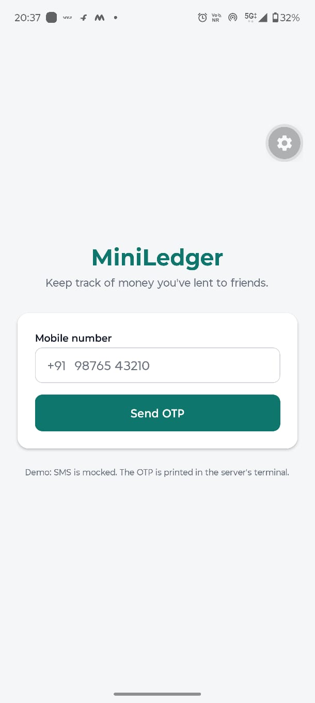
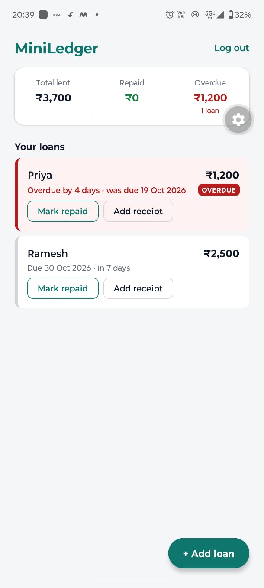
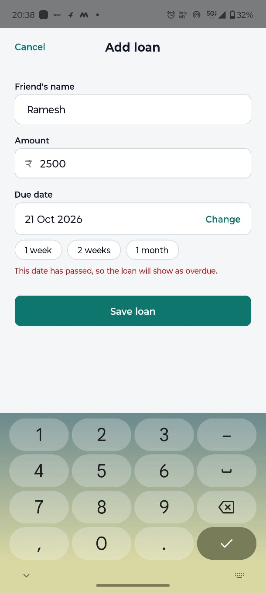
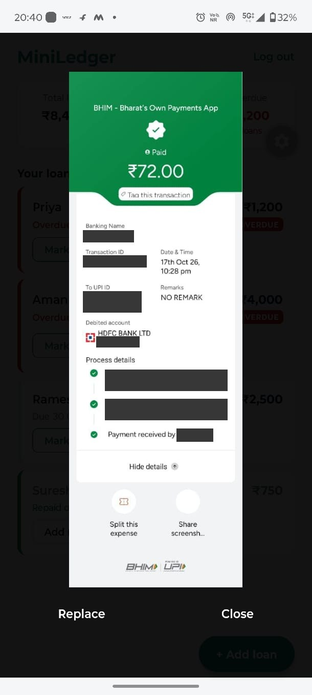

# MiniLedger

[](https://github.com/harshvsinghnorth/miniledger/actions/workflows/ci.yml)

A small app to track money you've lent to friends. Log in with your phone number, record who owes you how much and by when, see what's overdue at a glance, mark loans as repaid, and attach a photo of the receipt.

It's an Android app built with **React Native (Expo)**, talking to an API built with **Node.js, TypeScript, Fastify, Prisma and PostgreSQL**. Built as the take-home assignment for CredSetu's Full Stack Development internship.

## Screenshots

| Log in | Loans and summary | Add a loan | Receipt photo |
|---|---|---|---|
|  |  |  |  |

Taken on an Android phone in Expo Go (the grey gear is Expo's developer menu). Personal details in the sample receipt are blacked out.

---

## Features

**Required**
- **Phone login with a mock OTP.** A 6-digit code is printed in the server log (it's never returned by the API), and logging in returns a JWT.
- **Loans.** Add a loan (friend's name, amount in ₹, due date) and mark it as repaid.
- **Summary.** Total lent, total repaid and the overdue amount, computed in a single SQL query and shown as a card at the top of the list.
- **Overdue highlighting.** Overdue loans get a red edge, a red tint and an OVERDUE badge. Unpaid loans are listed first, earliest due date on top.

**Bonus**
- **Receipt photos.** Take a photo or pick one from the gallery. It's resized on the phone, stored privately, and only its owner can see it.
- **Validation and tests.** Every request body is checked with zod, and errors come back per field and appear under the right input in the app. 91 automated tests run against a real Postgres test database, and GitHub Actions runs them on every push.

**Extras**
- Loading, error (with retry), empty and **offline** states. Offline, the app keeps showing the last data with a banner, and refreshes itself when the connection returns.
- Indian formatting: `₹1,25,000`, `+91 98765 43210`, and "today" means today in India (IST).
- A Dockerfile for the API, and a one-command way to run the whole backend in Docker.

## Tech stack

| Part | Technology |
|---|---|
| App | React Native 0.86 with Expo SDK 57, TypeScript, expo-secure-store (token), expo-image-picker + expo-image-manipulator (receipts), expo-image, NetInfo |
| API | Node.js 22, TypeScript, Fastify 5, Zod 4, jsonwebtoken, @fastify/multipart |
| Database | PostgreSQL 17, through Prisma 7 (driver adapter `@prisma/adapter-pg`), with SQL migrations committed in `server/prisma/migrations` |
| Tests | Vitest, using Fastify's `inject()` against a separate `miniledger_test` database |
| Tooling | ESLint (typescript-eslint), GitHub Actions CI, Docker / Docker Compose |

## Project layout

```
miniledger/
├── docker-compose.yml        Postgres (and, with --profile app, the API in a container)
├── docker/init-test-db.sql   creates the miniledger_test database on first start
├── server/                   the API
│   ├── src/
│   │   ├── server.ts         entry point: starts listening
│   │   ├── app.ts            builds the Fastify app: logging, error handler, routes
│   │   ├── routes/auth.ts    request-otp, verify-otp, me
│   │   ├── routes/loans.ts   loans, repay, summary, receipts
│   │   ├── auth.ts           JWT signing + the requireAuth hook
│   │   ├── otp.ts            OTP generation, hashing, limits
│   │   ├── receipts.ts       upload rules: size, image type, file names
│   │   ├── validation.ts     zod schemas (phone, amount, dates, ids)
│   │   └── money.ts, dates.ts, sms.ts, config.ts, db.ts
│   ├── prisma/               schema.prisma + migrations
│   ├── tests/                unit and integration tests
│   └── Dockerfile
├── app/                      the Expo app
│   ├── App.tsx               logged in? → Home, else → Login
│   └── src/
│       ├── screens/          LoginScreen, HomeScreen, AddLoanScreen
│       ├── components/       SummaryCard, LoanRow, TextField, Button
│       ├── api.ts            the only place that calls fetch
│       └── config.ts, session.ts, format.ts, photos.ts, theme.ts
└── docs/LEARNING_NOTES.md    how and why everything is built the way it is
```

---

## Running it locally

### What you need
- **Node.js 22.12 or newer**, and **Docker Desktop** (running).
- An **Android phone** with **Expo Go** from the Play Store. The app uses Expo SDK 57, which is what the Play Store version runs.
- The phone and the laptop on the **same network** (see [Troubleshooting](#troubleshooting-the-phone-connection)).

### 1. Start the database

From the repository root:

```bash
docker compose up -d
```

This runs Postgres 17 on laptop port **5433** (to avoid clashing with a local Postgres on 5432). On first start it also creates the `miniledger_test` database for the tests.

### 2. Start the API

```bash
cd server
cp .env.example .env        # on Windows PowerShell: Copy-Item .env.example .env
npm install                 # also generates the Prisma client
npm run db:deploy           # creates the tables
npm run dev                 # starts the API on port 3000, restarting on changes
```

Check it at <http://localhost:3000/health>, which should return `{"ok":true}`. In `.env`, replace `JWT_SECRET` and `OTP_SECRET` with random values (the file shows a one-line command to generate them).

### 3. Start the app

In a second terminal:

```bash
cd app
npm install
npm start
```

Scan the QR code with **Expo Go**. There's no IP address to configure: the app calls the API on the same laptop that Expo Go loaded it from. To point it at another server, set `EXPO_PUBLIC_API_URL`.

### 4. Log in

Enter any Indian mobile number (e.g. `9876543210`) and tap **Send OTP**. The code appears in the API's terminal:

```
INFO: [mock SMS] OTP for +919876543210 is 482913
```

### Troubleshooting the phone connection
- Open `http://<laptop-ip>:3000/health` in the **phone's browser**. If that doesn't load, the app can't reach the API either.
- Some Wi-Fi networks (college, office, guest) stop devices from talking to each other. Use the **phone's hotspot** for the laptop instead.
- On Windows, allow **Node.js** through the firewall when asked.
- After switching networks, restart `npm start` so the QR code has the new address.
- "Project is incompatible with this version of Expo Go" means the project and Expo Go use different SDKs. This project is on SDK 57 to match the Play Store.

### Alternative: run the backend in Docker

```bash
docker compose --profile app up --build
```

This builds the API image, waits for Postgres, applies the migrations and starts the API on port 3000, with nothing else installed. In this mode the API logs JSON lines, so the OTP is in `docker compose logs -f api`. Stop `npm run dev` first, because both use port 3000.

---

## Tests and checks

```bash
cd server
npm test            # 91 tests, using the miniledger_test database (needs the database container running)
npm run lint
npm run typecheck   # app code and tests

cd ../app
npm run typecheck
```

The tests cover:
- the OTP flow: wrong codes, the 5-attempt lock (including 10 guesses at the same moment), one-time use, expiry, the resend cooldown and forged tokens;
- loans: validation errors, the overdue rules, ordering, repeating a repay, and **one user being unable to see or repay another user's loan**;
- the summary maths (e.g. ₹0.10 + ₹0.20 = ₹0.30 exactly);
- receipts: a script disguised as a JPEG is rejected, files over 5 MB are rejected, and nobody else can upload or download your receipt;
- the helpers: rupee/paise conversion, India's date at midnight, phone and amount parsing.

The tests refuse to run unless the database name ends in `_test`, so they can never wipe real data.

**CI** ([`.github/workflows/ci.yml`](.github/workflows/ci.yml)) runs on every push and pull request with three jobs:
- the server: install, lint, typecheck, build and the tests against a throwaway Postgres;
- the app: typecheck and building the Android bundle;
- building the Docker image.

## Environment variables

`server/.env` (copy from `server/.env.example`):

| Variable | Required | Meaning |
|---|---|---|
| `DATABASE_URL` | yes | Postgres connection string. The example points at the Docker database on port 5433. |
| `JWT_SECRET` | yes | Signs login tokens. At least 32 characters. |
| `OTP_SECRET` | yes | Key for hashing OTPs. At least 32 characters, different from `JWT_SECRET`. |
| `HOST` | no (`0.0.0.0`) | `0.0.0.0` so a phone on the network can connect. |
| `PORT` | no (`3000`) | |
| `UPLOADS_DIR` | no (`uploads`) | Where receipt photos are saved. |
| `NODE_ENV` | no | `production` switches logs to JSON lines. |

App (optional): `EXPO_PUBLIC_API_URL`, the full API address when not running from a laptop with Expo.

Tests use `server/.env.test` (committed; it only holds the test database and dummy secrets).

## API

All `/loans` routes need `Authorization: Bearer <token>`. Errors are JSON: `{ "error": "...", "fields": { "amount": ["..."] } }`.

| Method | Path | Body | Result |
|---|---|---|---|
| `GET` | `/health` | – | `{ ok: true }`, or 503 if the database is unreachable |
| `POST` | `/auth/request-otp` | `{ phone }` | Prints the OTP in the server log. 400 for a bad number, 429 within 30 s of the last code |
| `POST` | `/auth/verify-otp` | `{ phone, otp }` | `{ token, user }`. 401 for a wrong or expired code, 429 after 5 wrong attempts. Creates the user on first login |
| `GET` | `/auth/me` | – | `{ id, phone }` |
| `GET` | `/loans` | – | `{ loans: [...] }`, unpaid first. Each loan has `amount` (₹), `dueDate`, `repaidAt`, `isOverdue` and `receiptUrl` |
| `POST` | `/loans` | `{ friendName, amount, dueDate }` | 201 with the loan. `amount` in rupees (number or text, ≤ 2 decimals, ≤ ₹1 crore), `dueDate` as `YYYY-MM-DD` |
| `PATCH` | `/loans/:id/repay` | – | The loan, marked repaid. Repeating it changes nothing. 404 if it isn't your loan |
| `GET` | `/loans/summary` | – | `{ totalLent, totalRepaid, overdueAmount, overdueCount }` |
| `POST` | `/loans/:id/receipt` | multipart, one image | The loan with `receiptUrl`. JPEG/PNG/WebP only (415), at most 5 MB (413) |
| `GET` | `/loans/:id/receipt` | – | The image, to its owner only (404 for anyone else) |

---

## Design decisions

The full reasoning, with trade-offs, is in [`docs/LEARNING_NOTES.md`](docs/LEARNING_NOTES.md). The short version:

- **Money is stored as whole paise in an integer column.** Floats can't hold most decimals exactly (in JavaScript, `1.15 * 100` is `114.99999999999999`), so the server parses the rupee *text* into paise and never multiplies floats. A `CHECK (amount_paise > 0)` constraint in the database backs up the validation.
- **"Today" is today in India.** Overdue means *not repaid and due before today*, where today is the date in Asia/Kolkata, not the server's UTC date, which is still "yesterday" until 5:30 am IST. A loan due today isn't overdue yet. "Today" is computed once and passed into SQL as a parameter, so tests can control it.
- **The summary is one SQL query** using `SUM(...) FILTER (WHERE ...)`: one pass over the user's loans, and only four numbers sent back. The app never calculates money itself; it only formats it.
- **No IDOR.** The user id always comes from the verified JWT, never from the request, and every query includes it (`WHERE id = $1 AND user_id = $2`). Another user's loan, or receipt, returns 404, not 403, so its existence isn't revealed.
- **OTP security.** The code is a secure random number. Only an HMAC of it is stored, keyed with `OTP_SECRET`, so a leaked table is useless. It expires after 5 minutes, works once, and allows 5 attempts, counted with a conditional `UPDATE` so simultaneous guesses can't slip past the limit. There's a 30-second resend cooldown, because real SMS costs money.
- **Receipts are private and checked.** There's no public uploads folder: files are served by a protected route. Uploads are capped at 5 MB while streaming, the type is identified from the file's first bytes rather than its name, files are saved under random names, and they're served with `nosniff`.
- **Safe to retry.** Marking a loan repaid twice keeps the first repayment time, so a phone retrying on a bad network can't cause harm.
- **Stack.** Fastify, Zod, Prisma, Vitest and GitHub Actions are the tools named in CredSetu's job listing, all within the assignment's "Node.js + TypeScript + PostgreSQL / React Native".

## Assumptions and what's not done

- **No partial repayments.** A loan is either open or fully repaid, as the assignment describes.
- **No editing or deleting loans,** and **no pagination** on the list.
- **The OTP is mocked.** It's printed in the server log, as the assignment asks. A real SMS provider would replace one function (`server/src/sms.ts`).
- **One token, valid for 7 days, with no refresh tokens.** A token can't be revoked before it expires.
- **Rate limiting is per phone number** (cooldown and attempt limit), not per IP address.
- **The offline copy isn't saved.** Offline, the app shows the data it last loaded in memory; changes can't be made offline and queued for later.
- **Receipts are stored on the API server's disk.** Production would use object storage such as S3.
- **Tested on Android with Expo Go.** It isn't tested on iOS, it isn't deployed, and there's no standalone APK.

## What I'd build next

1. **Partial repayments.** A `repayments` table, with each loan's balance calculated from it, which is how udhaar works for shops.
2. **WhatsApp payment reminders** for overdue loans.
3. **Editing and deleting**, with a history of changes so disputes have a trail.
4. **Saving data on the phone**, so the app works fully offline and syncs later.
5. **Deployment:** the API on AWS (EC2 or ECS, RDS for Postgres, S3 with presigned URLs for receipts), refresh tokens, per-IP rate limiting, and an installable APK.

## How this was built

I used an AI coding assistant (Claude Code) throughout, which the assignment allows. I chose the stack and the scope, ran and tested every feature myself on my Android phone, and debugged the issues that only showed up on a real device. [`docs/LEARNING_NOTES.md`](docs/LEARNING_NOTES.md) is the record of how each part works and why.
